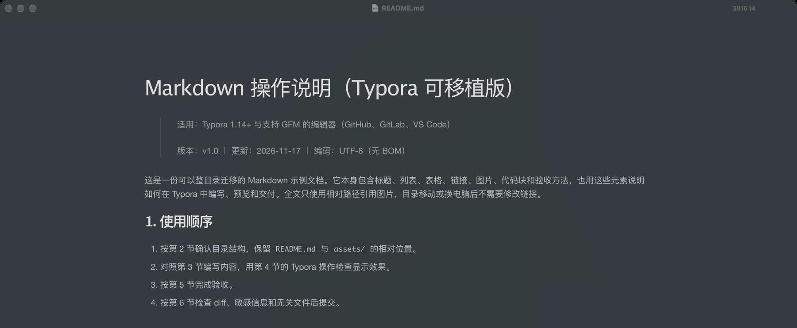

# Markdown 操作说明（Typora 可移植版）

> 适用：Typora 1.14+ 与支持 GFM 的编辑器（GitHub、GitLab、VS Code）
>
> 版本：v1.0 ｜ 更新：2026-11-17 ｜ 编码：UTF-8（无 BOM）

这是一份可以整目录迁移的 Markdown 示例文档。它本身包含标题、列表、表格、链接、图片、代码块和验收方法，也用这些元素说明如何在 Typora 中编写、预览和交付。全文只使用相对路径引用图片，目录移动或换电脑后不需要修改链接。

## 1. 使用顺序

1. 按第 2 节确认目录结构，保留 `README.md` 与 `assets/` 的相对位置。
2. 对照第 3 节编写内容，用第 4 节的 Typora 操作检查显示效果。
3. 按第 5 节完成验收。
4. 按第 6 节检查 diff、敏感信息和无关文件后提交。

> 只交付 `README.md` 会丢图片；正确做法是把整个目录一起拷贝、压缩或提交。

## 2. 目录结构与可移植约定

```text
考试/
├── README.md
├── assets/
│   ├── folder-structure.png
│   └── typora-preview.png
└── .git/                    # 本地版本库，交付时可忽略
```


*图 1：README.md 与 assets/ 必须保持同级关系；移动时整目录一起移动。*

可移植性依赖以下五条约定：

1. **图片只用相对路径**。统一写成 `assets/文件名.png`，路径基准是 md 文件所在目录；不要写以 `/` 开头的本机绝对路径，也不要写 `file://` 协议地址。
2. **保留相对位置**。`assets/` 与 `README.md` 同级；拷贝、压缩、`git clone` 时整目录一起操作。
3. **资源名用 ASCII**。文件名用小写英文字母、数字和短横线，不带空格；避免 Linux 区分大小写、URL 编码和不同系统解压后出现“图片丢失”。
4. **统一编码与换行**。文件保存为 UTF-8（无 BOM），换行使用 LF；Windows 上可通过 Git 的 `core.autocrlf` 处理换行差异。
5. **在 Typora 中打开文件夹**。选择 `File → Open Folder`，而不是只打开单个 md 文件；这样左侧文件树、图片基准和资源管理才一致。

下面三种写法只有最后一种可以随目录迁移：

```text
错误：/用户目录/项目/assets/folder-structure.png
错误：file:// 开头或 Windows 盘符开头的绝对地址
正确：assets/folder-structure.png
```

## 3. 语法示例

下面每节给出写法、效果和使用注意；本文件本身就是可运行的样例，可以直接在 Typora 中对照修改。

### 3.1 标题

```markdown
# 一级标题：文档名称
## 二级标题：章节
### 三级标题：小节
#### 四级标题：更细的层级
```

- 一级标题全篇只出现一次，作为文档名称。
- 井号与标题文字之间保留一个空格；Typora 中输入井号加空格后会自动转换。
- 不要用加粗文字冒充标题；Typora 的大纲（View → Outline）只识别井号标记。
- 层级不要跳级，例如不要从二级标题直接跳到四级标题。

### 3.2 列表

无序列表：

- 无序列表用短横线、星号或加号开头，同一层级保持同一种标记。
  - 嵌套项缩进 2–4 个空格；Typora 中按 Tab 会自动缩进。
  - 列表项较长时可以换行，但续行要缩进对齐。
- 列表与上下段落之间留一个空行，避免被合并进同一段。

有序列表：

1. 准备目录：`README.md` 与 `assets/` 同级。
2. 在 Typora 中打开文件夹。
3. 按验收清单逐项检查。
   1. 先跑自动检查。
   2. 再人工看图片、表格和链接。

任务列表：

- [x] 目录与图片已就位
- [x] 自动检查通过
- [ ] 在另一台电脑上打开验证

任务列表是 GFM 扩展，Typora 与 GitHub 支持；如果目标平台只支持 CommonMark，请改用普通无序列表。

### 3.3 表格

| 元素 | 推荐写法 | 典型用途 | 要点 |
|---|---|---|---|
| 标题 | 井号 + 空格 + 文字 | 章节层级 | 全篇只用一个一级标题 |
| 列表 | 短横线 + 空格 + 项目 | 步骤、清单 | 嵌套统一缩进 |
| 表格 | 表头 + 分隔行 + 数据行 | 参数、对照 | 各行列数一致 |
| 链接 | 方括号文字 + 圆括号地址 | 引用资料 | 外链写全协议 |
| 图片 | 感叹号 + 方括号说明 + 圆括号路径 | 截图、示意图 | 路径相对 md 文件 |
| 代码块 | 三个反引号 + 语言名 | 命令、配置 | 围栏成对且闭合不短于开头 |

列对齐由分隔行的冒号控制：

| 左对齐 | 居中 | 右对齐 |
| :--- | :---: | ---: |
| `:---` | `:---:` | `---:` |
| 内容 | 内容 | 128 |

- 表头、分隔行和数据行的列数必须一致；分隔行不能省略。
- 单元格里的竖线要写成反斜杠加竖线转义，否则会被当成新列。
- Typora 中输入一行竖线分隔的表头后回车，会自动补出分隔行；菜单「段落 → 表格」可以增删行列。
- 表格适合短文本对照；长段落改用列表或小节。

### 3.4 链接

- 行内链接：[Typora 官网](https://typora.io/)
- 带标题的链接：[CommonMark 规范](https://commonmark.org/ "CommonMark 官方站点")
- 自动链接：<https://github.github.com/gfm/>
- 相对链接：[打开目录结构图](assets/folder-structure.png)

使用注意：

- 外链写完整协议，例如以 `https://` 开头，不要只写 `www.example.com`。
- 相对链接与图片一样，以 md 文件所在目录为基准，适合链接同目录的附件。
- 链接文字要能说明去向，避免只写“点击这里”。
- Typora 中按住 ⌘ 点击链接可以打开；编辑状态下右键也有打开链接的命令。

### 3.5 图片

基础语法：

```markdown


```

实际效果：


- 替代文字不要省略：图片加载失败时它会显示，读屏软件也会读取它。
- 相对路径以 md 文件所在目录为基准。`assets/...` 表示当前目录下的 assets，`../assets/...` 表示上一级目录下的 assets。
- 图片要和 md 一起提交；只提交 md 文件，换一台电脑就会破图。
- Typora 设置：`Typora → 设置（Preferences）→ 图像（Image）`，选择把插入的图片复制到 `./assets`，并勾选优先使用相对路径。
- 不建议用 HTML 的 img 标签控制宽度：它属于 HTML，在部分纯 Markdown 渲染器中不显示；需要固定版式时优先导出 PDF/HTML。

### 3.6 代码块

行内代码用单个反引号包裹，例如 `git status --short`。

围栏代码块：

```bash
git status --short
git diff --cached --stat
```

如果代码本身包含三个反引号，就用四个反引号包住；下面示例展示这种嵌套写法：

````markdown
```bash
git status --short
```
````

- 开头围栏后可以写语言名（bash、python、json、markdown 等），用于语法高亮；不写也能渲染，只是没有高亮。
- 闭合围栏不能短于开头围栏；四个反引号开头就必须用四个或更多反引号闭合。
- 提交信息里包含反引号、美元符号或空格时，在 shell 中用单引号包裹，避免被展开。

### 3.7 引用与分隔线

> 引用适合放注意事项、来源说明或摘录。
>
> 第二段仍在同一个引用块内。

---

- 分隔线用三个或更多短横线、星号或下划线，前后留空行；否则可能被识别为标题下划线。
- 不要用连续分隔线代替标题层级。

## 4. Typora 操作要点

1. **打开文件夹**：`File → Open Folder`，选择包含 `README.md` 和 `assets/` 的目录，在左侧文件树中单击切换文件。只打开单个文件也能编辑，但看不到资源目录，容易漏拷图片。
2. **源码核对**：`View → Source Code Mode` 查看原始 Markdown。提交前切一次，确认表格分隔行、代码围栏和图片路径没有隐藏字符。
3. **图片设置**：`Typora → 设置（Preferences）→ 图像（Image）`，把插入图片复制到 `./assets` 并优先使用相对路径；拖拽或粘贴截图后检查路径是否为 `assets/...`。
4. **大纲与字数**：`View → Outline` 检查标题层级；底部状态栏查看字数和行数。
5. **导出**：`File → Export` 可导出 PDF 或 HTML 用于阅读和分发；版本管理仍以 `README.md + assets/` 为准，导出件不代替源文件。

关于目录：Typora 的 `[TOC]` 是扩展语法，GitHub 等平台不识别。需要跨平台目录时，手写链接或在目标平台使用自动生成的目录，不要依赖单一编辑器的扩展。

## 5. 验收方法

验收分两步：先跑自动检查，再按清单人工看渲染效果。全部通过才算完成。

### 5.1 自动检查

在项目根目录执行以下脚本。脚本检查图片与本地链接是否存在、是否出现本机绝对路径、代码围栏是否成对，以及必备文件是否齐全；任一项失败都会以非零状态退出。

```bash
python3 - <<'PY'
from pathlib import Path
import re
import sys

root = Path.cwd()
md = root / "README.md"
text = md.read_text(encoding="utf-8")
errors = []

# 1) 图片与本地链接必须指向真实文件
for target in re.findall(r"!\[[^\]]*\]\(([^)\s]+)", text):
    if "/" not in target and "." not in target:
        continue
    if not (md.parent / target).exists():
        errors.append(f"图片缺失：{target}")

for target in re.findall(r"(?<!!)\[[^\]]+\]\(([^)\s]+)", text):
    if target.startswith(("http://", "https://", "#", "mailto:")):
        continue
    if "/" not in target and "." not in target:
        continue
    if not (md.parent / target).exists():
        errors.append(f"链接目标缺失：{target}")

# 2) 不出现本机绝对路径
for no, line in enumerate(text.splitlines(), 1):
    if re.search(r"file:/{3}|(?<![\w:])/(?:Users|home)/", line):
        errors.append(f"第 {no} 行含绝对路径：{line.strip()}")

# 3) 代码围栏成对，且闭合围栏不短于开启围栏
fence = None
for no, line in enumerate(text.splitlines(), 1):
    m = re.match(r"^(`{3,}|~{3,})", line)
    if not m:
        continue
    mark = m.group(1)
    if fence is None:
        fence = mark
    elif mark[0] == fence[0] and len(mark) >= len(fence):
        fence = None
if fence:
    errors.append(f"代码围栏未闭合：{fence}")

# 4) 必备文件
for name in ["README.md", "assets/folder-structure.png", "assets/typora-preview.png"]:
    if not (root / name).is_file():
        errors.append(f"缺少文件：{name}")

print(f"检查 {len(text.splitlines())} 行；图片与本地链接已核对")
if errors:
    print("验收失败：")
    for e in errors:
        print(" -", e)
    sys.exit(1)
print("验收通过：路径、图片、代码围栏均正常")
PY
```

输出最后一行应为：

```text
验收通过：路径、图片、代码围栏均正常
```

### 5.2 人工验收清单

| 编号 | 验收项 | 操作 | 通过标准 |
|---|---|---|---|
| A1 | 打开方式 | 用 Typora 打开整个文件夹，再点 README.md | 左侧出现 assets 目录，图片可显示 |
| A2 | 标题层级 | View → Outline | 只有一个一级标题，层级连续 |
| A3 | 列表 | 查看 3.2 节 | 无序、有序、嵌套和任务列表都正常，缩进不串行 |
| A4 | 表格 | 查看 3.3 节 | 表头、分隔行和边框完整，对齐正常 |
| A5 | 链接 | 按住 ⌘ 点击 3.4 节的外链 | 浏览器打开 Typora 与 CommonMark 页面 |
| A6 | 图片 | 查看 3.5 节和 5.3 节 | 两张图片都显示，没有破图图标 |
| A7 | 代码块 | 查看 3.6 节 | bash 高亮正常，四个反引号的嵌套示例完整显示 |
| A8 | 可移植 | 复制整个目录到新路径后重新打开 | 图片与相对链接仍然有效，无需改路径 |

补充检查：断网后重新打开本文件，图片仍应显示；如果使用图床或外链图片，断网时会破图，不符合本文件的“可移植”要求。

### 5.3 验收记录

| 日期 | 环境 | 自动检查 | 人工验收 | 结论 |
|---|---|---|---|---|
| 2026-11-17 | macOS · Typora 1.14.15 | 通过：图片与本地链接存在、绝对路径 0 处、围栏成对 | 抽查 3.2–3.6 节渲染正常；整目录复制检查通过 | 通过 |



*图 2：在 Typora 1.14.15 中打开本目录后的渲染效果。*

## 6. Git 提交与推送

以下命令都在项目根目录执行。原则是精确暂存、先看后提交；不要用 `git add .` 把无关文件一起带进去。

### 6.1 提交前检查 diff、敏感信息与无关文件

首次把本目录纳入 Git 时，先初始化仓库；已有仓库可跳过这一步：

```bash
git init -b main
```

然后按顺序检查：

```bash
# 1. 工作区概览：确认只有本次文件
git status --short

# 2. 精确暂存（不要用 git add .）
git add README.md assets/folder-structure.png assets/typora-preview.png

# 3. 看暂存区 diff 与文件清单
git diff --cached --stat
git diff --cached --name-status
git diff --cached

# 4. 敏感信息扫描：0 命中才继续
git diff --cached -U0 | grep -nEi 'pass[w]ord|secr[e]t|api[_-]?k[e]y|BEGIN [A-Z ]*PRIVATE K[E]Y|gh[pousr]_|sk-[A-Za-z0-9]{16,}|AKIA[0-9A-Z]{16}|/Use[r]s/|file:/{3}' \
  && echo "↑ 有命中，逐条人工确认" \
  || echo "敏感信息：0 命中"

# 5. 空白错误、冲突标记与最终清单
git diff --cached --check
git status --short
```

检查要点：

- **diff**：新文件在未暂存时不会出现在 `git diff` 中，所以先精确暂存，再用 `git diff --cached` 看完整内容。暂存不等于提交，仍可修改后重新暂存。
- **敏感信息**：重点看密码、令牌、私钥、云厂商密钥、个人主目录绝对路径和本机文件协议地址。上面的扫描命中任何一条都要先人工确认，不能直接提交。
- **无关文件**：`git status --short` 应只出现本次的 3 个文件；出现系统缩略图、缓存、个人笔记等，先判断来源，不属于本次交付就不要添加。
- **可读性**：`git diff --cached --check` 没有输出，说明没有行尾空格、冲突标记等常见问题。

### 6.2 提交并查看结果

```bash
git commit -m "docs: add portable Typora markdown guide"
git log -1 --stat
git show --stat --oneline HEAD
```

提交后 `git log` 会显示提交号、作者、日期和文件统计；`git show --stat` 用于再次确认本次提交只包含预期的文件。

### 6.3 本次提交记录

| 项目 | 结果 |
|---|---|
| 分支 | main |
| 纳入文件 | README.md、assets/folder-structure.png、assets/typora-preview.png |
| 提交信息 | docs: add portable Typora markdown guide |
| 提交前检查 | diff 已核对；敏感信息 0 命中；无无关文件；空白检查无输出 |
| 提交号 | 运行 git log -1 --format='%h %s' 查看 |

本文不写死提交号：提交号会随文档修改而变化，写进文档会造成自引用。以仓库中的 `git log -1` 为准，终端输出会同步展示在交付说明里。

### 6.4 远程仓库与推送（可选）

本目录已配置远程仓库并推送 `main` 分支。后续更新时：

```bash
git remote -v
git push origin main
```

远程仓库与链接记录：

```text
远程仓库：https://github.com/SakuraLoveSmile/Typora-Temp.git
推送状态：已推送（main）
链接：https://github.com/SakuraLoveSmile/Typora-Temp
```

注意：推送会把内容写到远程，执行前确认仓库地址、可见性和授权；本地提交成功不等于已推送。

## 7. 参考

- [CommonMark 规范](https://commonmark.org/)
- [GitHub Flavored Markdown 规范](https://github.github.com/gfm/)
- [Typora 官方文档](https://support.typora.io/)
